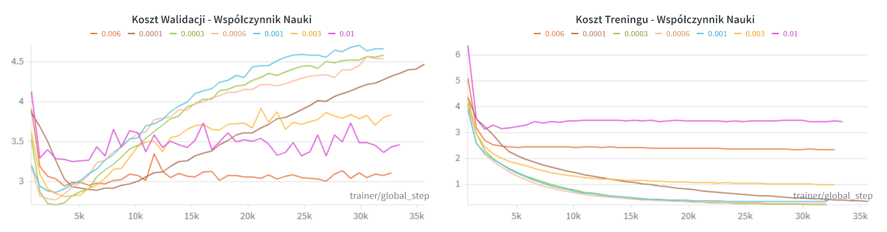
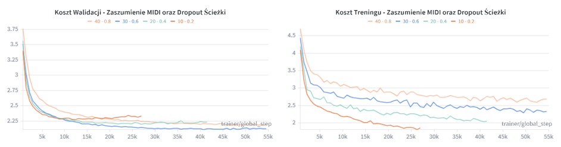
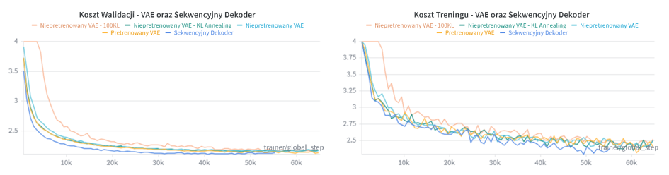
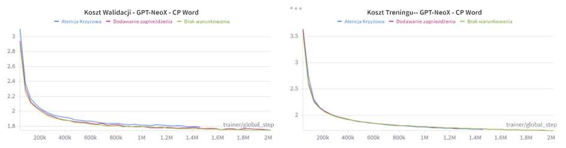
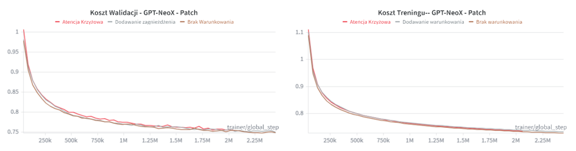
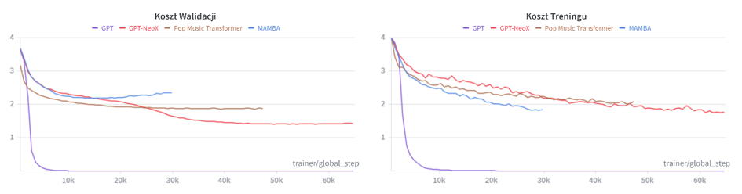
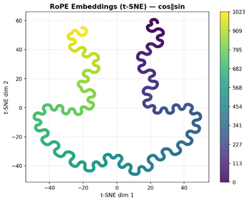
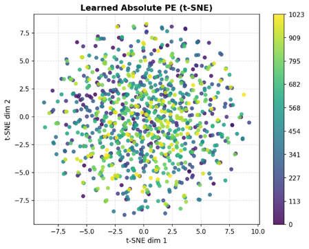
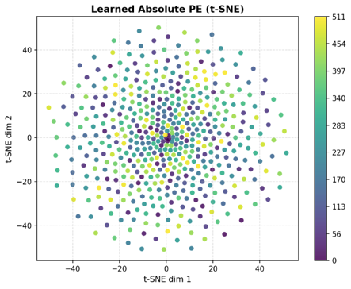
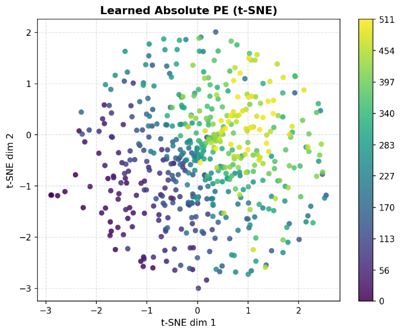

# Research Results

# Experimental Results

## Reference model configuration

The initial experiments used the following reference configuration.

| Parameter | Value |
| --- | --- |
| Dataset | POP909 |
| Generative architecture | Sequential decoder without a VAE encoder |
| Decoder | Pop Music Transformer |
| Music representation | REMI |
| Maximum sequence length | 1,024 tokens |
| Hidden representation dimension | 768 |
| Decoder layers | 1 |
| Dropout | 0.1 |

## Training experiments

### Learning rate

The figure compares training and validation cross-entropy loss for different learning rates. At sufficiently low learning rates, the model was able to fit the training sequences: training loss continued to decrease. However, validation loss eventually increased while training loss kept falling, indicating overfitting. This behavior appeared after the initial reduction in validation loss, and its onset depended on the learning rate. The experiment therefore showed that learning the training sequences does not necessarily translate into better generalization.

### Augmentation and regularization

Data augmentation introduced small perturbations to note timing and note velocity in MIDI files. MIDI tracks were also randomly removed. These changes were evaluated together with modifications to the model dropout rate, allowing the experiments to examine both augmentation and stronger regularization. The reported musical-quality results indicated a benefit from augmentation on POP909 and a slight deterioration on MAESTRO. Changes in training loss alone did not establish an improvement in generated music.

### VAE and latent conditioning

The conditioning experiments evaluated the following ways of incorporating additional information into the decoder:

- **Vector addition:** adding the conditioning vector to the decoder representation.
- **Concatenation:** concatenating the conditioning vector with the decoder input representation.
- **Cross-attention:** allowing the decoder to attend to the conditioning representation.
- **Adaptive Layer Normalization (AdaLN):** using the conditioning information to modulate layer normalization.

The latent-conditioning experiments also compared pretrained CLaMP2 encoders with encoders initialized without pretraining. The tested VAE variants did not demonstrate an improvement from latent conditioning over the sequential decoder. This result concerns the evaluated configurations and does not establish that latent conditioning is ineffective in general.

### Genre conditioning on five MidiCaps classes

#### Compound Word

#### Patch

The genre-conditioning experiments included vector addition and cross-attention. The tested methods did not demonstrate effective control over the generated genre. The class-wise FMD comparison below provides an additional evaluation of this behavior.

### Sequential decoder comparison

GPT produced a surprising result: its training and validation loss fell to extremely low values, yet its generated samples did not exhibit correspondingly high musical quality. GPT-NeoX ranked second by the cross-entropy loss used as the training and validation criterion. Most subsequent experiments therefore focused on GPT and GPT-NeoX, investigating their representations, conditioning methods, and generated samples. The discrepancy between GPT loss and sample quality showed why loss needs to be considered alongside sample validity and musical evaluation.

## Generated-sample playability

Results are reported as counts out of 100 samples, following the presentation. A dash indicates an unreported result.

### GPT

| Dataset | REMI | CP-Word | Patch |
| --- | --- | --- | --- |
| POP909 | 91/100 | 100/100 | 1/100 |
| MAESTRO | 98/100 | 100/100 | 5/100 |
| MidiCaps | — | 100/100 | 6/100 |

### GPT-NeoX

| Dataset | REMI | CP-Word | Patch |
| --- | --- | --- | --- |
| POP909 | 99/100 | 87/100 | 14/100 |
| MAESTRO | 100/100 | 99/100 | 60/100 |
| MidiCaps | — | 100/100 | 49/100 |

## Musical metrics

The tables reproduce the reported metric values. The presentation does not specify units or the exact aggregation procedure for these metrics.

### Pitch range

#### GPT

| Dataset | REMI | CP-Word | Patch |
| --- | --- | --- | --- |
| POP909 | 0.5100 | 0.0000 | 3.8723 |
| MAESTRO | 0.0000 | 0.0000 | 14.4200 |
| MidiCaps | — | 3.1700 | 23.3789 |

#### GPT-NeoX

| Dataset | REMI | CP-Word | Patch |
| --- | --- | --- | --- |
| POP909 | 19.8900 | 23.4458 | 112.0714 |
| MAESTRO | 59.2800 | 53.7108 | 86.9833 |
| MidiCaps | — | 39.3800 | 91.1538 |

### Pitch entropy

#### GPT

| Dataset | REMI | CP-Word | Patch |
| --- | --- | --- | --- |
| POP909 | 0.0006 | 0.0067 | 1.1216 |
| MAESTRO | 0.0000 | 0.0000 | 0.6889 |
| MidiCaps | — | 0.0016 | 0.4900 |

#### GPT-NeoX

| Dataset | REMI | CP-Word | Patch |
| --- | --- | --- | --- |
| POP909 | 2.3570 | 2.2822 | 5.0072 |
| MAESTRO | 4.6143 | 3.9572 | 4.1720 |
| MidiCaps | — | 2.7941 | 2.6083 |

### Polyphony

#### GPT

| Dataset | REMI | CP-Word | Patch |
| --- | --- | --- | --- |
| POP909 | 1.0077 | 1.0000 | 1.2224 |
| MAESTRO | 1.0000 | 1.0000 | 2.4630 |
| MidiCaps | — | 1.1374 | 2.2989 |

#### GPT-NeoX

| Dataset | REMI | CP-Word | Patch |
| --- | --- | --- | --- |
| POP909 | 1.0651 | 1.0537 | 28.1068 |
| MAESTRO | 1.8631 | 3.1568 | 12.8994 |
| MidiCaps | — | 4.7101 | 11.8860 |

## Fréchet Music Distance (FMD)

### GPT

| Dataset | REMI | CP-Word | Patch |
| --- | --- | --- | --- |
| POP909 | 654.3433 | 845.4358 | 697.7755 |
| MAESTRO | 589.1340 | 674.7022 | 554.5711 |

### GPT-NeoX

| Dataset | REMI | CP-Word | Patch |
| --- | --- | --- | --- |
| POP909 | 520.5598 | 490.4807 | 619.5100 |
| MAESTRO | 312.0014 | 509.6364 | 459.7065 |

## Class-wise FMD for genre conditioning

The following matrix was reported for a **GPT model using Compound Word and genre conditioning** on the five-class MidiCaps subset. It preserves the class order and all values from the earlier presentation. The original table did not explicitly identify which axis represents generated samples and which represents reference samples.

| | Class 0 | Class 1 | Class 2 | Class 3 | Class 4 |
| --- | --- | --- | --- | --- | --- |
| Class 0 | 580.43 | 617.71 | 606.42 | 589.41 | 601.72 |
| Class 1 | 539.08 | 567.64 | 562.77 | 542.31 | 559.72 |
| Class 2 | 614.05 | 631.67 | 627.87 | 615.95 | 630.52 |
| Class 3 | 576.68 | 607.66 | 600.20 | 581.31 | 596.67 |
| Class 4 | 507.21 | 540.34 | 535.21 | 516.50 | 526.59 |

The diagonal is not consistently the lowest entry within a row or column. The matrix therefore does not show a consistent same-class advantage, in line with the reported difficulty in obtaining effective genre control.

## Results after GAN fine-tuning

The following results use REMI. The base models were trained on MAESTRO and then fine-tuned using GAN training on MAESTRO or POP909.

### Musical metrics

#### GPT

| Metric | MAESTRO | POP909 |
| --- | --- | --- |
| Pitch range | 1.0400 | 0.0000 |
| Pitch entropy | 0.0256 | 0.0000 |
| Polyphony | 1.0110 | 1.0000 |

#### GPT-NeoX

| Metric | MAESTRO | POP909 |
| --- | --- | --- |
| Pitch range | 54.8400 | 21.4300 |
| Pitch entropy | 4.4678 | 2.1947 |
| Polyphony | 2.0253 | 1.1102 |

### FMD

The matrices retain the row and column dataset labels from the presentation. Their roles (generated-sample dataset versus reference dataset) were not explicitly identified in the source.

#### GPT

|  | MAESTRO | POP909 |
| --- | --- | --- |
| MAESTRO | 533.70 | 680.45 |
| POP909 | 606.23 | 726.17 |

#### GPT-NeoX

|  | MAESTRO | POP909 |
| --- | --- | --- |
| MAESTRO | 340.75 | 562.69 |
| POP909 | 400.42 | 510.57 |

## Audio examples

Embedded playback requires a Markdown renderer that supports HTML audio and can resolve the `assets/` directory. Download links are provided as a fallback. For local playback, open [audio_examples.html](audio_examples.html) after extracting the complete archive.

### GPT

[Listen to or download the WAV sample](assets/gpt.wav)

<audio controls preload="none" src="assets/gpt.wav"></audio>

### GPT-NeoX — MAESTRO

[Listen to or download the WAV sample](assets/gpt_neox_maestro.wav)

<audio controls preload="none" src="assets/gpt_neox_maestro.wav"></audio>

### GPT-NeoX — POP909

[Listen to or download the WAV sample](assets/gpt_neox_pop909.wav)

<audio controls preload="none" src="assets/gpt_neox_pop909.wav"></audio>

### GAN GPT-NeoX — MAESTRO

[Listen to or download the WAV sample](assets/gan_gpt_neox_maestro.wav)

<audio controls preload="none" src="assets/gan_gpt_neox_maestro.wav"></audio>

### GAN GPT-NeoX — POP909

[Listen to or download the WAV sample](assets/gan_gpt_neox_pop909.wav)

<audio controls preload="none" src="assets/gan_gpt_neox_pop909.wav"></audio>

## Positional-encoding visualizations

### GPT-NeoX

### GPT — MAESTRO — Compound Word

### GPT — MAESTRO — Patch

### GPT — MidiCaps — Patch

The rotary positional-encoding visualization showed a more ordered structure than the learned absolute positional encodings. The t-SNE plots describe embedding geometry; they do not, by themselves, establish a causal explanation for musical quality.

## Conclusions

- **Low cross-entropy loss does not guarantee good music.** GPT configurations reached very low loss values without producing correspondingly high-quality samples.
- **Rotary positional encoding performed better in the evaluated experiments.** GPT-NeoX produced better musical results than GPT, while its positional-encoding visualization showed a more ordered structure. Other architectural differences may also contribute to the performance gap.
- **Dataset diversity matters.** Augmentation improved the reported results on POP909 but slightly worsened them on MAESTRO.
- **REMI and Compound Word gave comparable results.** Patch frequently produced invalid MIDI despite favorable values for some musical metrics and FMD.
- **Fine-tuning on a different dataset could provide a modest benefit.** The reported experiments suggest a benefit from transferring a model trained on MAESTRO to POP909.
- **The tested latent and genre conditioning did not provide effective control.** These findings apply to the implemented configurations.

## Potential next steps

- Develop a training objective that better reflects the musical quality of generated sequences.
- Improve Patch-to-MIDI decoding and evaluate how this changes sample validity and musical quality.
- Investigate more effective conditioning methods and verify that the model actually uses the supplied conditioning information.
